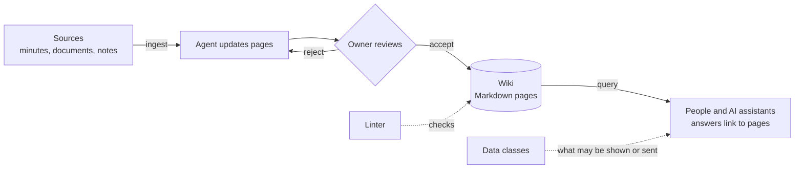

# Commonmind

[](https://github.com/michael-rechberger/commonmind-llm-wiki/actions/workflows/ci.yml)

**Open rules for team LLM wikis, with governance built in.** A specification for wikis in which AI
agents write the pages and people review them, with clear rules on what may be shown to whom and
sent to which AI model.

📖 **[Read the specification → SPEC.md](SPEC.md)** · builds on
[Karpathy's LLM wiki pattern](https://gist.github.com/karpathy/442a6bf555914893e9891c11519de94f)
and the [Open Knowledge Format (OKF) v0.2](https://github.com/GoogleCloudPlatform/open-knowledge-format/blob/main/SPEC.md)

A page is a plain Markdown file with a small header:

```yaml
---
type: project
title: Globex Data Platform
description: Building a shared data platform for Globex, 2026.
status: stable
project_status: active
owner: human:jdoe
data_class: confidential
tags: [data-platform]
sources:
  - id: kickoff
    resource: sources/inbox/2026-03-02-globex-kickoff.md
    title: Kick-off notes
    author: human:jdoe
generated: {by: wiki-update/1.2, at: "2026-10-16T09:00:00Z"}
verified:
  - {by: human:jdoe, at: "2026-10-16T10:30:00Z"}
stale_after: "2027-04-01T00:00:00Z"
---
```

Every Commonmind page is a valid OKF concept. Tools that only know OKF can read it.

## How it works



- **Ingest:** you hand an agent a source; it updates the affected pages and logs the change.
- **Review:** the owner of a page accepts or rejects the agent's change.
- **Query:** people and AI assistants look things up, with links to the pages and their sources.
- **Lint:** a linter checks the format; the agent looks for contradictions and gaps.
- **Data classes:** each page carries a class; applications show or send only what the class
  allows. Confidential content that not every reader may see goes into a separate wiki.

## Quickstart

1. **Start from the example wiki.**

   ```bash
   git clone --depth 1 https://github.com/michael-rechberger/commonmind-llm-wiki
   cp -r commonmind-llm-wiki/examples/acme-wiki my-wiki
   ```

   In `my-wiki/commonmind.yaml`, set `wiki_id`, `title`, your types and your data classes.
   Replace the ACME pages with your own or delete them.

2. **Let your agent run it.** `my-wiki/AGENTS.md` holds the operating instructions for an AI
   coding agent (Claude Code, Codex or similar). Put a first source into `sources/inbox/` and ask
   the agent to ingest it. Review the changed pages before you accept them.

3. **Check it, without installing anything:**

   ```bash
   uvx --from git+https://github.com/michael-rechberger/commonmind-llm-wiki commonmind-lint my-wiki
   ```

   Errors must be fixed; warnings point to pages that need attention.

## Why

Teams lose knowledge: decisions sit in meeting notes nobody finds, facts live in one person's
head, and wikis go stale because nobody has time to keep them. Commonmind lets an AI agent do the
writing: you hand it a source (minutes, a document, notes), it updates the right pages, and a
person checks the result. Everyone, including an AI assistant, can then look things up, with a
link to the page and its sources.

What sets Commonmind apart from other LLM wiki projects: it is not a tool but a specification
with **governance built in**. Who owns a page, who reviews it, which data class it has, what an
application may show or send to an AI model, how personal data is handled, how meetings flow in.

## What Commonmind is, and is not

| Commonmind is | Commonmind is not |
|---|---|
| A **format** for the pages (plain Markdown files with a small header, an OKF profile) | An app, a platform or a hosted service |
| **Operating rules**: who writes, who reviews, how sources and meetings flow in | A user interface, a search engine or a choice of AI model |
| **Duties for applications** that show pages or send them to an AI model (data classes) | A permission system: access is separated by keeping confidential content in separate wikis |
| A **starter kit**: a linter today, guides and agent prompts next | Tied to any company or tool |

**Who can use it today:** teams with someone comfortable with Git, Markdown and an AI coding agent.
**Who should wait:** teams that need a ready-made app or a setup without any technical help.
Guides, agent prompts and a described reference setup are planned (see [Roadmap](#roadmap)).

**Running a wiki on Commonmind?** Share your setup and your experience in
[Discussions](https://github.com/michael-rechberger/commonmind-llm-wiki/discussions).

**Legal note:** Commonmind is not legal advice and does not by itself make a wiki compliant with
data protection or AI law. It is designed to support typical duties such as data minimisation,
access and erasure, and transparency about AI-generated content.

## Where it comes from

Commonmind combines two existing ideas:

- **The LLM wiki pattern** ([Karpathy](https://gist.github.com/karpathy/442a6bf555914893e9891c11519de94f))
  defines *how the wiki is run*: raw sources stay untouched, an LLM maintains the wiki pages,
  and three operations (ingest, query, lint) keep it alive. The pattern deliberately leaves
  the file format open.
- **The Open Knowledge Format (OKF) v0.2**
  ([spec](https://github.com/GoogleCloudPlatform/open-knowledge-format/blob/main/SPEC.md))
  defines *what a file contains*: YAML frontmatter with a `type`, provenance, review and
  expiry, Markdown links, `index.md` files. OKF says nothing about who writes or how.

Commonmind is an **OKF profile** for LLM wikis that several people use: it fixes the
vocabulary and adds what a team needs and OKF leaves open, namely ownership, data
classification, project status, links between wikis, and the operating rules.

## What is in this repository

| Path | Content |
|---|---|
| [`SPEC.md`](SPEC.md) | The specification (normative) |
| [`schema/page.schema.json`](schema/page.schema.json) | JSON Schema for page frontmatter |
| [`schema/meeting.schema.json`](schema/meeting.schema.json) | JSON Schema for meeting files (agenda, minutes) |
| [`templates/`](templates/) | Page templates for agents and people |
| [`examples/acme-wiki/`](examples/acme-wiki/) | A small example wiki (fictional content) |
| [`src/commonmind_lint/`](src/commonmind_lint/) | Linter `commonmind-lint` (starter kit, not normative) |
| [`CHANGELOG.md`](CHANGELOG.md) | Changes per version |
| [`CONTRIBUTING.md`](CONTRIBUTING.md) | How to propose changes |

## Roadmap

Each step is published once it runs in a real wiki.

1. **1.1** (now): specification, schema, templates, example, linter, migration tools.
2. **Next:** data classes for sources, health figures and freshness checks in the linter,
   agent prompts for ingest, query, lint and review, a privacy and confidentiality guide, a second
   example wiki outside consulting, a described reference setup.
3. **Then:** guidance for teams in which several people and agents write at the same time, and
   graded review of agent changes.
4. **Exploring:** wikis for product and project teams.

## Linter

```bash
uv run commonmind-lint path/to/wiki            # errors fail, warnings are listed
uv run commonmind-lint --strict path/to/wiki   # warnings fail too
uv run commonmind-lint --summary path/to/wiki  # counts per check, no paths or content
```

`uv run commonmind-inventory path/to/wiki` counts Obsidian-style constructs before a migration
(Appendix A): fields, tags, wiki links, embeds, callouts, file names, log headings. Counts only,
no names or text.

`uv run commonmind-migrate --generated-by agent:<id> path/to/wiki` migrates an Obsidian-style
wiki (Appendix A). Judgment comes from two prepared files, `tools/migration/migration-map.yaml`
(new path, type, relation per file) and `tools/migration/description-map.yaml` (one sentence per
page); the rest is mechanical. All-or-nothing, `--dry-run` writes nothing, output is counts only.
`--domain-title people=Personen` sets display titles of domains in index pages.

The linter checks the deterministic part of the lint operation (section 8): profile file, root and
domain `index.md`, frontmatter against the schema and the profile (types, data classes, folder
defaults, relations, tags, actors), file names, editor syntax (wiki links, embeds, callouts),
broken links, orphan pages, overdue `stale_after`, self-review, local sources, footnotes, `log.md`
headings and meeting files. It does not compare versions (class lowering, append-only log); that
needs version control. Organizations add their own rules with `load_wiki()` and `lint()` from
Python.

## Relation to other work

- [`shinzui/okf-profiles`](https://github.com/shinzui/okf-profiles) introduced the term
  *OKF profile* (house conventions on top of OKF, written in Dhall). Commonmind uses the
  same idea with JSON Schema and YAML.
- [`zby/commonplace`](https://github.com/zby/commonplace) is a framework and doctrine for
  agent-operated LLM wikis with types, schemas and validators. Commonmind is narrower: a
  format and operating profile for teams, based on OKF.

## License

© 2026 Michael Rechberger. Each part has the license that fits its use; `REUSE.toml` maps every
file to its license, the texts are in [`LICENSES/`](LICENSES/).

| Part | License | In short |
|---|---|---|
| Specification and documentation (`SPEC.md`, `README.md`, `CHANGELOG.md`, `CONTRIBUTING.md`) | [CC BY 4.0](LICENSES/CC-BY-4.0.txt) | Share and adapt, also commercially, with attribution |
| Linter and JSON Schema (`src/`, `schema/`, `tests/`) | [MIT](LICENSES/MIT.txt) | Use in any tool, keep the copyright notice |
| Templates and example wiki (`templates/`, `examples/`) | [CC0 1.0](LICENSES/CC0-1.0.txt) | Copy into your own wiki, no attribution needed |

Maintained by [Michael Rechberger](https://github.com/michael-rechberger).
